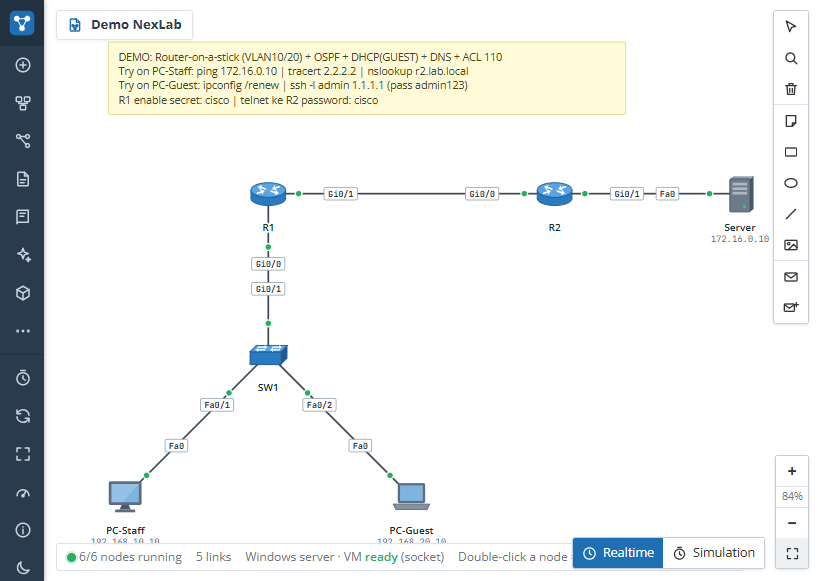
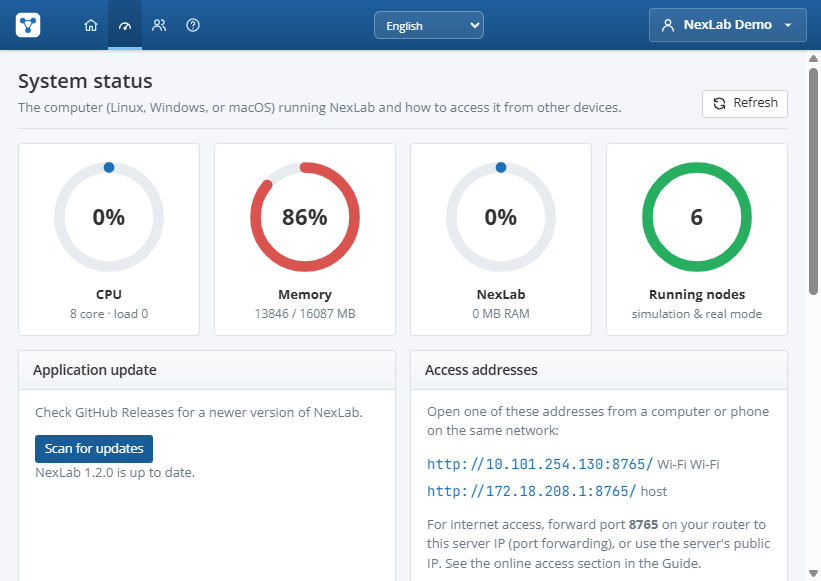
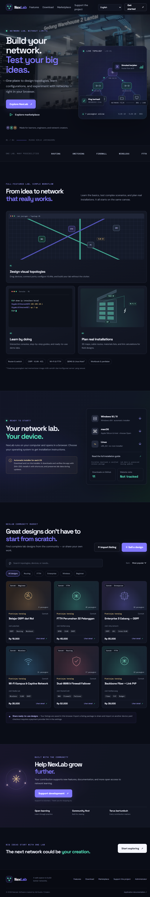
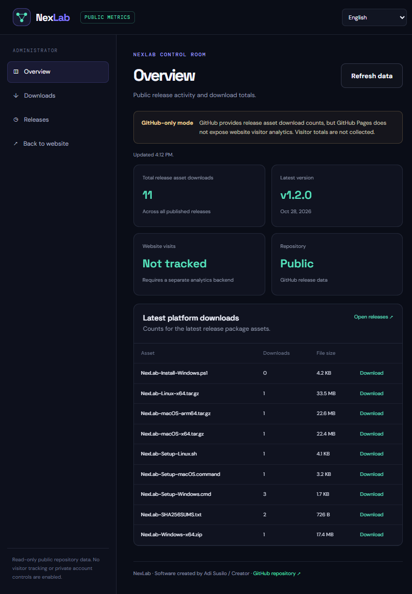

# NexLab — Lab Jaringan Pribadi (ala PNETLab + Packet Tracer)

NexLab adalah aplikasi lab jaringan berbasis web. Server-nya berjalan di komputer **Linux, Windows, atau macOS** dengan backend **Python**, lalu diakses dari browser komputer lain lewat IP jaringan server, atau dari internet jika IP server dipublikasikan.

Dibuat supaya **ringan**: node simulasi (router, switch, firewall, PC) praktis tidak memakan RAM/CPU sehingga laptop lama atau mini PC 2 GB RAM sudah cukup. Untuk lab yang butuh paket sungguhan, tersedia node real (QEMU, Linux host, Cloud bridge) seperti di PNETLab.

## Fitur

**Akun & akses**
- Login dan registrasi. Akun pertama otomatis menjadi **admin**.
- Admin bisa mengatur peran, menonaktifkan akun, reset password, dan menutup pendaftaran.
- Sesi cookie HttpOnly, password di-hash PBKDF2, pembatasan percobaan login, proteksi CSRF.
- Server listen di `0.0.0.0` sehingga bisa dibuka dari semua IP jaringan yang terhubung; HTTPS opsional.
- **Jaringan Windows**: halaman Status Sistem menampilkan NIC, alamat IPv4/gateway, dan neighbor yang sudah tercatat di cache ARP. Ping satu IP Windows/LAN atau alamat publik seperti `8.8.8.8`; IP neighbor dapat dipilih untuk konfigurasi node Perangkat Fisik. NexLab tidak melakukan pemindaian subnet.
- **Pembaruan Windows**: admin dapat memasang rilis GitHub langsung dari Status Sistem. Arsip aplikasi diverifikasi dengan SHA-256; folder `Update` dipakai untuk staging dan file unduhan dibersihkan setelah pemasangan berhasil. Database, lab, image, serta virtualenv instalasi source tetap dipertahankan.
- **Batas kewenangan**: akun pengguna NexLab hanya mengatur data melalui UI; perubahan source dan penerbitan rilis dikendalikan di GitHub oleh pemilik repository. Password aplikasi bukan kunci untuk mengubah source.

### Persetujuan perubahan kode (pemilik repository)

Semua perubahan source melalui pull request. `.github/CODEOWNERS` menetapkan `@Mrx112` sebagai pemilik seluruh file, dan workflow **Owner approval** memeriksa bahwa persetujuan pemilik berlaku untuk commit terbaru sebelum pull request dapat lolos pemeriksaan. Jika ada commit baru setelah persetujuan, pemilik harus meninjau ulang. Perubahan yang dibuat langsung oleh pemilik ditandai sebagai perubahan pemilik; persetujuan rilis tetap dibutuhkan.

Workflow rilis menolak penerbit selain `Mrx112` dan menggunakan environment `nexlab-release`. Di **Settings → Environments → nexlab-release**, atur `Mrx112` sebagai required reviewer. Karena rilis dimulai oleh pemilik yang sama, jangan aktifkan pencegahan self-review kecuali ada publisher tepercaya lain yang memulai deployment; tanpa itu pemilik tidak dapat menyetujui rilisnya sendiri. Di **Settings → Rules → Rulesets**, buat ruleset branch `master` untuk mewajibkan pull request, review Code Owner, dan pemeriksaan `Owner approval / latest commit`; blokir force push/penghapusan, dan batasi akses tulis/bypass ke pemilik saja. Buat juga ruleset tag `v*` yang membatasi pembuatan/pembaruan/penghapusan tag hanya untuk pemilik. Atur Actions default GITHUB_TOKEN ke read-only.

Pengguna akhir memakai rilis aplikasi dan tidak memerlukan akses repository atau file source. Kontrol GitHub melindungi source/rilis resmi, bukan salinan yang sudah diunduh: pemilik komputer masih dapat memodifikasi binary lokal. Jangan memasukkan password ke source, commit, log, atau chat; bila password sempat dibagikan, segera ganti.

**Editor topologi**
- Drag & drop perangkat, kabel antar port (pilih interface seperti PNETLab/Packet Tracer), lampu status link (hijau/kuning/merah), label interface, catatan, zoom/pan, menu klik-kanan, autosave.
- Console HTML5 (xterm.js) di jendela mengambang, bisa banyak sekaligus atau dibuka di tab baru.
- Panel inspektor: nyala/mati/wipe, IP PC lewat GUI (static/DHCP, seperti tab Desktop Packet Tracer), layanan DHCP & DNS di Server, uji ping cepat dengan animasi paket, lihat running/startup-config.
- Ekspor/impor lab (`.nexlab.json`), template lab (kosong, LAN dasar, OSPF 3 site, demo lengkap).

**Perangkat simulasi (CLI ala Cisco IOS)**
| Perangkat | Kemampuan |
|---|---|
| Router (ISR4331) | interface & sub-interface 802.1Q (router-on-a-stick), static route, OSPF, RIP, DHCP server & relay (`ip helper-address`), ACL standard/extended, loopback, telnet/SSH (`line vty`, `username`, `crypto key`) |
| Switch L2 (2960) | VLAN, access/trunk, native & allowed VLAN, `interface range`, SVI manajemen, `ip default-gateway`, MAC table, CDP |
| Switch L3 (3650) | semua fitur L2 + `ip routing`, SVI inter-VLAN, `no switchport`, OSPF/RIP |
| Firewall | router IOS dengan ACL in/out per interface |
| PC / Laptop / Server | Command Prompt ala Packet Tracer: `ipconfig`, `ping`, `tracert`, `nslookup`, `arp`, `telnet`, `ssh`; Server punya DHCP & DNS |
| Cloud / Hub | segmen bersama (simulasi) atau bridge ke NIC fisik (real) |

CLI mendukung singkatan (`sh ip int br`, `conf t`), `?` untuk bantuan, **Tab** untuk melengkapi, riwayat panah atas/bawah, `do` di mode config, filter `| include / exclude / begin / section`, pesan `%LINK-5-CHANGED`, password console/enable/vty, `write memory`, `copy run start`, `reload`, `erase startup-config`. Ping memperhitungkan routing dua arah, ARP (paket pertama hilang), ACL dan status interface.

**Perangkat tambahan (versi 1.1)**
| Perangkat | Kemampuan |
|---|---|
| Access Point | SSID, WPA2/WPA3/Open, channel; klien wireless hanya tersambung bila SSID & password cocok |
| Smartphone, Tablet, IoT | klien WiFi (port Wireless0), perintah `wifi <ssid> <password>` |
| Laptop | port kabel FastEthernet0 **dan** WiFi Wireless0 |
| Printer, IP Phone, Kamera CCTV | end device dengan Command Prompt |
| Hub | satu segmen bersama |
| OLT / ODP (splitter) / ONT | rantai FTTH GPON: OLT ber-CLI switch dengan port GPON, ODP pasif 1:2–1:16, ONT bridge |

**Script & layanan di Server/PC**
- Setiap PC/server punya **Script otomatis** (panel kanan): `echo`, `set`, `${var}`, `sleep`, `repeat … end`, `if ping … else … end`, dan semua perintah Command Prompt. Jalankan dari panel atau console: `script`, `run <nama>`.
- Server punya layanan **DHCP, DNS dan HTTP** (isi `index.html` sendiri); PC bisa `curl http://…/` dan `browser <nama>`.

**Panel Panduan (tombol "? Panduan" / F1 / menu Panduan)**
- Pencarian kata kunci **bahasa Indonesia** dengan sinonim: "firewall", "blokir ping", "wifi tamu", "fiber ke rumah", "kabel rapi", "antena antar gedung", "mikrotik limit", dll.
- 45+ tutorial langkah demi langkah: dasar CLI, VLAN, trunk, inter-VLAN, routing statis/OSPF/RIP, DHCP/relay, DNS/HTTP, ACL/firewall, SSH, NAT, WiFi, PtP, FTTH, instalasi fiber, manajemen kabel, RJ45, script, QEMU, perangkat fisik, MikroTik, Linux, troubleshooting.
- Tombol **Kirim ke console** memasukkan perintah ke console perangkat yang sedang terbuka.
- Kalkulator subnet/wildcard, power budget fiber GPON, dan link budget wireless + zona Fresnel.

**Peta 3D (tab "Peta 3D" di editor)**
- Bangunan bertingkat (rumah 1–2 lantai, kantor, gedung) dengan dinding tembus, tangga, riser kabel, filter per lantai.
- Perangkat dalam ruangan (rack, router, switch, patch panel, AP plafon, ONT, PC, printer, CCTV, outlet) dan luar ruangan (OLT, ODC, tiang, tower, ODP, joint closure, handhole), antena dish/sektor/omni.
- **Tarik kabel otomatis rapi**: naik ke cable tray di bawah plafon, ikut sumbu bangunan, pindah lantai lewat riser, keluar dinding terdekat; fiber udara melewati tiang dengan lendutan (sag), atau tanam dalam pipa.
- Jenis kabel: UTP Cat6, fiber SM, drop cable, coaxial, listrik, link wireless.
- Tab **Kabel** (tabel + label, unduh CSV), **Material** (BOM: perangkat, meter kabel + slack, RJ45, konektor SC, tray, klem; unduh CSV), **Budget** (daya terima tiap ONT dari OLT lewat splitter; RSSI, LOS & Fresnel tiap link PtP), **Standar** (aturan pemasangan).
- Template: "Rumah 2 lantai + FTTH (OLT–ODC–ODP–ONT)" dan "2 gedung + PtP wireless + fiber cadangan".
- Objek 3D bisa dihubungkan ke node topologi (klik ganda = buka console).

**Integrasi Claude CLI (bangun lab dari prompt)**
- Tombol **Buat dengan Claude** di halaman Main dan menu **Claude AI** di sidebar editor: tulis permintaan (mis. "3 VLAN dengan router-on-a-stick, DHCP dan ACL") → Claude membuat perangkat, kabel, konfigurasi IOS, IP perangkat akhir, layanan server, dan workbook beserta cek penilaiannya.
- Mode **Ubah / tambah ke lab ini** (lab yang ada dikirim sebagai konteks) atau **Ganti seluruh lab**; pilihan model (default CLI, Sonnet, Opus, Haiku).
- **Tanya Claude**: tanya jawab tentang lab yang sedang dibuka (mis. "kenapa ping gagal?"), Claude membaca topologi dan running-config.
- Memakai `claude` CLI yang terpasang di komputer server dan **akun yang login di CLI itu** (`claude auth status`), sehingga NexLab tidak menyimpan API key. Status, versi, dan akun tampil di **Status sistem**; admin bisa memulai `claude auth login` dari sana.
- Default hanya admin; admin dapat mengizinkan pengguna lain (pemakaian dihitung ke akun CLI tersebut). Lokasi CLI bisa diatur lewat variabel `NEXLAB_CLAUDE`.

**Fitur ala PNETLab**
- Workbook / tugas lab (instruksi markdown) dengan **penilaian otomatis** (cek ping, isi config, node menyala, kabel) dan skor.
- Timer lab, beberapa **config set** per lab (simpan/muat startup-config semua node), ekspor semua config (.txt), impor config ke node.
- Desain kabel (warna, gaya, tebal), ukuran ikon & posisi label node, objek teks/persegi/elips/garis/gambar (background), mode gelap kanvas.
- Admin: daftar **lab yang sedang berjalan** dari semua pengguna (join / stop).

**Fitur ala Cisco Packet Tracer**
- Mode **Realtime / Simulasi** (Shift+R / Shift+S): PDU sederhana & kompleks (ICMP/TCP/UDP + port), daftar skenario PDU, **event list** langkah demi langkah dengan animasi amplop, filter protokol, dan info PDU per layer OSI.
- Alat **Select, Inspect** (tabel routing/ARP/MAC/VLAN/ACL), **Delete**, Note, Draw shape, Resize; **Undo** (Ctrl+Z) dan pintasan keyboard (`?`).

**Perangkat real (butuh server dijalankan sebagai root)**
| Node | Fungsi |
|---|---|
| QEMU VM | menjalankan image asli (Cisco vIOS/vIOSL2, CSR1000v, Arista vEOS, MikroTik CHR, VyOS, FortiGate, pfSense, Linux…), tiap NIC adalah TAP, console serial di browser, KVM otomatis jika ada |
| Linux Host | network namespace dengan stack TCP/IP asli dan shell bash (hampir 0 MB RAM) |
| Cloud | bridge ke NIC fisik/bridge host → lab tersambung ke **switch/router sungguhan** |
| Perangkat Fisik | console Telnet/SSH dari browser ke perangkat jaringan sungguhan di LAN (atau terminal server untuk kabel console) |

Setiap kabel antar node real dibuat sebagai Linux bridge (STP/CDP/LLDP diteruskan).

> Catatan jujur: node simulasi adalah emulasi CLI, bukan IOS asli, dan tidak mengirim paket ke jaringan fisik. Kabel antara node simulasi dan node real ditampilkan putus-putus kuning dan hanya bersifat dokumentasi. Untuk lalu lintas nyata ke perangkat fisik, gunakan node QEMU/Linux Host yang dikabelkan ke Cloud. Image vendor (mis. Cisco) tidak disertakan karena berlisensi; gunakan image milik Anda sendiri.

## Kebutuhan

- Linux apa saja (Ubuntu/Debian/Mint/Fedora, juga Raspberry Pi), Python 3.9+.
- Mode simulasi: ±60 MB RAM, tanpa root.
- Mode real: root, `iproute2`; untuk VM: `qemu-system-x86`, `qemu-utils`, sebaiknya CPU dengan KVM.

## Download dan instalasi desktop

Installer unduhan berbeda untuk setiap OS. Buat tag versi dengan format `vMAJOR.MINOR.PATCH` untuk menjalankan [.github/workflows/release.yml](./.github/workflows/release.yml). Setelah build Windows, macOS Intel/Apple Silicon, dan Linux berhasil, GitHub Actions menerbitkan paket aplikasi beserta SHA-256 dan installer ke [GitHub Releases](https://github.com/Mrx112/nexlab/releases). Build desktop harus dijalankan pada runner OS tujuan; jangan mengemas virtual environment atau database developer.

Website statis di folder `WebSite/` diterbitkan melalui GitHub Pages dari branch `master` oleh [.github/workflows/pages.yml](./.github/workflows/pages.yml). Bila GitHub Pages belum pernah diaktifkan, workflow meminta izin `pages: write` untuk menyiapkannya. Tombol unduhan menggunakan aset release terbaru:

- Windows x64: unduh `NexLab-Setup-Windows.cmd`, kemudian klik ganda. Installer mengambil paket dan skrip Windows dari GitHub Releases, memeriksa SHA-256, memasang aplikasi di `%LOCALAPPDATA%\Programs\NexLab`, membuat shortcut Desktop/Start Menu, lalu menjalankan NexLab.
- macOS Intel dan Apple Silicon: unduh `NexLab-Setup-macOS.command`, lalu jalankan `bash ~/Downloads/NexLab-Setup-macOS.command` dari Terminal (sesuaikan folder unduhan). Installer memilih paket sesuai arsitektur, memeriksa SHA-256, memasang `NexLab.app` di `~/Applications`, membuat alias Desktop, lalu membukanya. Aplikasi belum ditandatangani atau dinotariskan.
- Linux x86_64: unduh `NexLab-Setup-Linux.sh`, kemudian jalankan `bash ~/Downloads/NexLab-Setup-Linux.sh` (sesuaikan folder unduhan). Installer memeriksa SHA-256, memasang aplikasi untuk akun pengguna tanpa root, membuat pintasan menu dan Desktop bila tersedia, lalu menjalankannya. Jika perlu, pasang `curl`, `tar`, `sha256sum`/`shasum`, dan `pgrep` dari package manager distro.

Paket aplikasi membawa NexLab dan aset `static/`, serta tidak memerlukan instalasi Python terpisah. Pemutakhiran mengganti file aplikasi saja dan meminta pengguna menutup NexLab terlebih dahulu. Database, akun, konfigurasi, dan lab pengguna tidak disertakan di paket rilis dan tidak dihapus saat aplikasi diperbarui:

- Windows: `%LOCALAPPDATA%\NexLab\data`
- macOS: `~/Library/Application Support/NexLab/data`
- Linux: `${XDG_DATA_HOME:-~/.local/share}/nexlab`

### Memeriksa update dari aplikasi

Buka **Status sistem → Scan for updates** untuk membandingkan versi aplikasi dengan GitHub Release stabil terbaru. Di Windows, admin dapat memilih **Pasang update sekarang**; NexLab mengunduh rilis bertag terbaru, memverifikasi SHA-256 untuk paket aplikasi, lalu menutup dan membuka ulang aplikasi setelah update. Arsip sementara ditempatkan di folder `Update` pada folder aplikasi dan dihapus setelah pemasangan berhasil. Instalasi source mempertahankan `.git`, `.venv`, dan `data`; instalasi resmi mempertahankan data pada folder OS di atas. Di macOS/Linux, halaman tetap menyediakan tautan unduhan installer.

Jika update gagal, file sementara dipertahankan untuk diagnosis di folder `Update`; log updater ada di `%LOCALAPPDATA%\NexLab\logs\update.log`. Build GitHub Actions saat ini menargetkan Windows x64, macOS Intel x64 dan Apple Silicon arm64, serta Linux x86_64. Paket macOS belum ditandatangani/notarized, dan paket Linux mensyaratkan distro berbasis glibc yang kompatibel dengan runner Ubuntu 22.04.

Updater memasang rilis versi stabil yang dipublikasikan sebagai tag GitHub (format `vX.Y.Z`), bukan setiap commit branch. Push kode ke `master`, lalu buat/push tag versi yang sama dengan versi aplikasi, saat ini `v1.3.0`; setelah workflow release selesai, rilis dapat dipasang langsung dari aplikasi Windows.

### Instalasi dari source (developer/server)

Installer lama untuk memasang source dan dependensi Python tersedia terpisah: `installers/windows/install-from-source.bat`, `installers/macos/install-from-source.command`, dan `installers/linux/install-from-source.sh`. File `install-windows.bat`, `install-macos.command`, dan `install.sh` di root hanya menjadi wrapper kompatibilitas untuk skrip developer ini. Gunakan `start-windows.bat`, `start-macos.command`, atau `start.sh` untuk menjalankan server dari source.

Tanpa installer:
```bash
pip install -r requirements.txt
python3 run.py --port 8080
```

Server mencetak alamat akses, misalnya `http://192.168.1.20:8080/`. Buka alamat tersebut dari browser dan daftar akun (akun pertama = admin). Jalankan dengan `sudo` hanya bila fitur Linux Host atau bridge NIC fisik diperlukan.

Opsi `run.py`: `--host`, `--port`, `--data`, `--cert`, dan `--key`. Saat dibekukan sebagai aplikasi, data tersimpan di folder data OS di atas; `NEXLAB_DATA` atau opsi `--data` dapat mengubah lokasinya.

## Menghubungkan ke perangkat fisik

1. Jalankan server sebagai root.
2. Cara paling aman: pakai NIC kedua (USB LAN pun bisa) yang dicolok ke switch/router fisik. Atau jadikan NIC utama sebagai bridge: `sudo scripts/make-bridge.sh eth0` (membuat `pnet0`, IP dipindah ke bridge; jalankan dari console lokal).
3. Di editor, taruh node **Cloud**, pilih target `eth1` atau `pnet0`.
4. Kabelkan node **QEMU VM** atau **Linux Host** ke Cloud. Node tersebut kini berada di segmen L2 yang sama dengan perangkat sungguhan (bisa ping, DHCP, OSPF, CDP/LLDP dengan perangkat fisik).
5. Untuk mengakses CLI perangkat fisik langsung dari browser, tambahkan node **Perangkat Fisik** dan isi IP/port Telnet atau SSH-nya.

## Image QEMU

Susunannya mirip PNETLab, satu folder per image:
```
data/images/qemu/vios/vios.qcow2
data/images/qemu/csr1000v/hda.qcow2
data/images/qemu/mikrotik-7.15/chr.img
data/images/qemu/linux-alpine/alpine.iso
```
Setiap node membuat disk overlay sendiri di `data/runtime/`, jadi image asli tidak berubah. Tombol wipe menghapus overlay tersebut.

## Akses online (internet)

1. Port forwarding di router: TCP 8080 (atau port pilihan) → IP lokal server.
2. Buka firewall server: `sudo ufw allow 8080/tcp`.
3. Disarankan HTTPS: `sudo ./start.sh --cert fullchain.pem --key privkey.pem`, atau taruh di belakang Caddy/Nginx (header `X-Forwarded-For` didukung; WebSocket di path `/ws/`).
4. Setelah akun Anda jadi, matikan registrasi di menu **Pengguna**.

Contoh Caddy:
```
lab.domainanda.com {
    reverse_proxy 127.0.0.1:8080
}
```

## Struktur

```
run.py              entry point server
server/app.py       HTTP API, auth, WebSocket console
server/cli.py       CLI IOS & Command Prompt PC
server/net.py       engine simulasi: VLAN/trunk, routing, OSPF/RIP, ACL, DHCP, DNS, ping
server/runtime.py   status lab, power node, sesi console
server/real.py      QEMU, netns, bridge, telnet/SSH console
server/templates.py katalog perangkat
server/demo.py      template lab
static/             UI (HTML/CSS/JS, xterm.js lokal — tetap jalan tanpa internet)
data/               database SQLite, image, runtime (dibuat otomatis)
```

## Website NexLab

Website promosi dan marketplace komunitas tersedia di folder `WebSite/`. Buka `WebSite/index.html` untuk melihatnya, atau sajikan folder tersebut dengan web server statis. Urutan 240 gambar di `WebSite/bg/` ditampilkan sebagai latar sinematik yang mengikuti scroll; versi WebP terkompresi disimpan di `WebSite/bg/optimized/` agar lebih ringan. File PNG asli diabaikan Git melalui `.gitignore`.

Katalog bawaan ditandai sebagai contoh. Kreator dapat menyimpan listing beserta file lab NexLab di penyimpanan browser, mengunduh file tersebut, atau mengekspor dan membagikan paket listing untuk diimpor di browser lain. Ini adalah alur berbagi statis, bukan marketplace server: pembayaran perlu dihubungkan pada `WebSite/config.js` sebelum menjual file berbayar. Tombol unduhan per OS sudah diarahkan ke installer pada GitHub Release terbaru; setelah rilis pertama tersedia, installer mengambil paket aplikasi, memeriksa SHA-256, memasang NexLab, dan membuat shortcut. Isi `donateUrl` dan `checkoutUrl` di file konfigurasi yang sama untuk mengaktifkan tautan donasi dan checkout.

Website dibuat oleh Adi Susilo / Creator.

## Tangkapan layar dan showcase

Berikut tampilan NexLab saat digunakan: editor topologi demo, pemantauan sistem dengan pemeriksaan update, serta website promosi dan dashboard statistik publik GitHub. Dashboard hanya menampilkan data rilis/unduhan publik; kunjungan website tidak dilacak.










## Lab demo

Template "Rumah FTTH + WiFi terkonfigurasi": Server-ISP (DHCP/DNS/web) – R-ISP – OLT – ODP 1:8 – ONT – router rumah (DHCP) – switch rumah – AP WiFi (SSID `Rumah-WiFi`, password `rumah12345`) + laptop, HP, PC, CCTV. Di PC-Kerja jalankan `run cek-internet`.


Pilih "Demo lengkap terkonfigurasi" saat membuat lab: router-on-a-stick VLAN 10/20, OSPF R1–R2, DHCP pool GUEST di R1, DNS di Server, ACL 110 yang memblok SSH dari VLAN GUEST ke server farm, SSH `admin/admin123` ke R1, telnet ke R2 (password `cisco`), enable secret R1 `cisco`.
